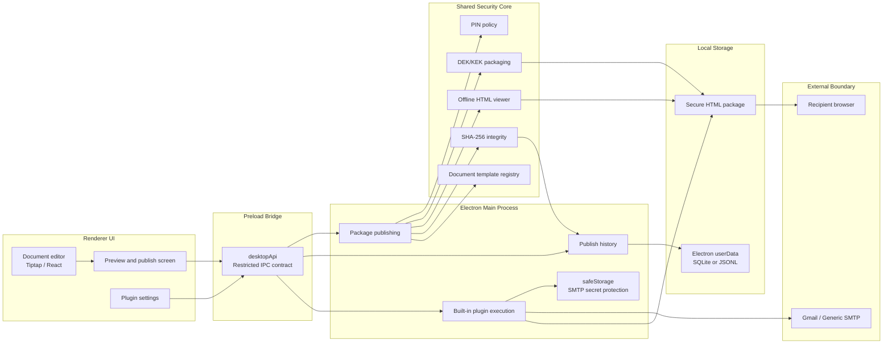

# Secure Doc Admin

[](LICENSE)


**Language:** English | [한국어](README_ko.md)

**Quick Links:** [Quick Start](#quick-start) · [Features](#features) · [Architecture](#architecture) · [Supported Platforms](#requirements) · [Design Principles](#design-principles) · [Security Model](#security-model)

Secure Doc Admin is an offline secure document issuer built with Electron, React, and TypeScript. Administrators write documents, publish PIN-protected single-file HTML packages, and recipients open those packages in a browser with a separately delivered PIN.

## Features

- Tiptap-based WYSIWYG body editing and HTML view mode
- Document type classification and explicit template application flow
- Korean and English admin UI switching in Settings, plus per-document offline viewer language selection
- Default document templates and a built-in template-pack plugin
- 6 to 15 character PIN policy, weak PIN blocking, and `crypto.getRandomValues()` based PIN generation
- PBKDF2-HMAC-SHA-256 based KEK derivation
- AES-256-GCM body encryption with separated DEK and KEK roles
- Single-file HTML viewer generation with no external resources
- CSP `connect-src 'none'`
- Publish history, package SHA-256 recording, and saved-file integrity audits
- Secure HTML attachment delivery through Gmail SMTP and Generic SMTP plugins
- Publish completion step with Show in folder, Copy file path, and Copy PIN for manual delivery through Teams, Outlook, or a messenger
- Optional email delivery from the publish completion step or publish history when an SMTP plugin is enabled
- Strict default publish policy with stronger policy plugins merged conservatively
- Branding preset plugin for issuer, watermark, and viewer color settings
- Bright Product Launch Light based bento card UI with a three-item sidebar: Write document, Publish history, Settings
- No storage of plaintext PINs, PIN hashes, plaintext document bodies, DEKs, or KEKs

## Architecture



The renderer collects document body and publish inputs, but it does not store plaintext PINs, PIN hashes, plaintext bodies, DEKs, or KEKs. The preload layer exposes only a restricted IPC contract. The main process owns publishing, history persistence, built-in plugin execution, and SMTP secret protection. Encryption and packaging rules live in `src/shared/` so they can be tested outside Electron.

## Authoring Flow

The document details panel shows only the fields needed to publish: title, issuer, recipient, document number, display expiration date, and watermark text. Document type, admin memo, and publishing operator are grouped in the collapsible `Additional details` section.

Choosing a document type changes classification metadata. It does not overwrite the body automatically. If a template exists for the selected type, the template selection moves so the user can clearly see the next available action.

To replace the body, press the `Apply template to body` button. If the document already has body content, the app uses an internal confirmation dialog before overwriting it.

Default templates:

- `core.notice`: notice or announcement
- `core.contract`: contract or consent document
- `core.policy`: policy or regulation document
- `core.general`: general secure document

When the `template-pack.business-samples` plugin is enabled, insurance certificate and billing statement templates are added. The insurance certificate template includes basic information, coverage information, and an issuance confirmation table similar to a membership certificate sample. Template packs do not load executable code. They only contribute trusted static template IDs from the bundled app.

## Publish and Hand-Off

The publish dialog asks for the PIN and viewer language. It does not offer a KDF iteration choice: the package always uses the effective publish policy minimum (1,000,000 PBKDF2 iterations by default, or a stronger policy profile minimum).

After the file is saved, the dialog stays open on a `Published` step instead of closing. It shows the saved path and offers `Show in folder`, `Copy file path`, and `Copy PIN`, plus `Send by email` when an SMTP delivery plugin is enabled. The step reminds the operator to send the PIN through a different channel than the document. The manual flow (save the file, then hand the file and PIN over through Teams, Outlook, or an internal messenger) works without any plugin. The PIN is cleared from app state when this step closes.

## Multilingual Display Policy

The admin UI supports Korean (`ko`) and English (`en`). The app's default admin language is Korean. The selected admin display language is stored by the Electron main process in a local settings file under `userData`, not in browser storage. Language settings are managed in the `Settings` screen, not through an immediate picker at the bottom of the sidebar.

The Settings screen also contains `Extensions` (plugin toggles and SMTP settings) and `Security information` (a static summary of the core security model), and shows the current app version and prerelease channel information. The version from `package.json` is passed to the renderer through the Electron main process. Production menus do not expose Electron's default developer tools or edit menus.

## Design Principles

The UI follows the project-scoped `.claude/skills/apple-bento-grid` guidance with a Product Launch Light theme: bright backgrounds, white bento cards, low shadows, and a neutral sidebar. Sidebar icons use local SVG versions of Lucide security-document icons. Because the app is an offline desktop tool, it does not load external web fonts or remote visual resources and uses the system UI font stack.

Per-document offline viewer language is selected in the publish dialog. The default is the current admin display language. The selected value is written into package metadata as `ui.language`, `ui.keyLabel`, `ui.helpText`, and `ui.unlockError`. This metadata must not contain PINs, PIN hashes, plaintext bodies, DEKs, or KEKs.

Generated viewers display unlock guidance, PIN labels, progress states, and public error messages in the package viewer language. Older packages without language metadata fall back to Korean.

## Built-In Plugins

Plugins run only through bundled manifests and allowlisted main-process actions. External plugin code, remote registries, and runtime JavaScript loading are not supported. Every plugin must be explicitly enabled in local state before its contributions appear. Plugins are managed in Settings > Extensions. While a plugin is disabled, its UI is hidden rather than shown as disabled: template-pack templates, the branding preset picker and publish-dialog branding summary, the publish history email column, and the `Send by email` button.

Encryption, PIN/key handling, the DEK/KEK structure, the offline viewer, CSP, and package integrity verification are core security surfaces. Plugins cannot replace or weaken those areas. They may only extend delivery channels, static templates, branding presets, and operational/reporting helpers.

Current built-in plugins:

- `delivery.smtp.gmail`: sends secure HTML packages through Gmail SMTP.
- `delivery.smtp.generic`: sends secure HTML packages through an arbitrary SMTP server such as an internal relay.
- `template-pack.business-samples`: adds insurance certificate and billing statement templates.
- `branding.company-defaults`: applies organization issuer, default watermark, and viewer color presets.

Plugin permissions and contribution points are documented in [docs/plugin-api.md](docs/plugin-api.md).

## Delivery Plugins

Gmail SMTP and Generic SMTP share the same secure path. The renderer sends only the saved package identifier and delivery inputs. It does not put document plaintext, PINs, PIN hashes, DEKs, KEKs, or raw HTML attachment contents in IPC payloads.

Shared permissions:

- `network:smtp`: SMTP connection and email sending
- `secret:safeStorage`: encrypted SMTP password storage
- `package:read`: read published secure HTML attachments
- `history:read`: find resend targets in publish history
- `ui:settings`: show plugin settings UI
- `ui:publish-action`: show post-publish delivery actions

Shared actions:

- `test-smtp`: runs Nodemailer `transporter.verify()` with saved settings.
- `send-email`: attaches the saved secure HTML after publishing and sends it to one recipient.
- `send-email-from-history`: attaches a saved file from publish history and sends it to one recipient.

Gmail SMTP uses `smtp.gmail.com:587` with STARTTLS and a Google app password. App passwords are NFKC-normalized, stripped of whitespace, and accepted only when they are 16 characters long. Generic SMTP supports host, port, STARTTLS requirement, sender address, username, and password settings.

Neither channel returns plaintext passwords to the renderer. Passwords are saved as base64-encoded results from Electron `safeStorage.encryptString()`. Before delivery, the main process checks the publish history `documentId`, `outputPath`, and `packageSha256`, then attaches the file only when the current SHA-256 matches the recorded hash.

Email bodies contain only a fixed notice. Document plaintext, PINs, PIN hashes, DEKs, and KEKs are never included in email bodies.

## Publish Policy

The default publish policy validates PIN length, PIN strength, minimum KDF iterations, and PIN confirmation matching. These conditions always apply regardless of plugin state:

- PIN length of at least 6 characters
- PBKDF2 iteration count of at least 1,000,000
- Recipient, document number, display expiration date required
- Watermark text required

New documents receive a default document number shaped like `PREFIX-YYYYMMDD-A1B2`, with letters and numbers derived from the creation date. The document number field can regenerate it with its issue-number button.

Policy profile plugins may only add requirements stronger than the defaults. When several policy profiles are active, the app conservatively merges the strongest minimum PIN length, strongest minimum KDF iteration count, union of required metadata, and watermark requirement. See [docs/publish-policy-plugins.md](docs/publish-policy-plugins.md) for details.

## Branding Preset

`branding.company-defaults` provides static presets for document basics and viewer presentation.

Branding presets may apply:

- Default issuer
- Watermark text
- Safe color tokens for the offline viewer, editor, and preview

Viewer theme values only allow literal `#rrggbb` colors. Presets cannot contain remote images, external fonts, external scripts, or network URLs. Applied viewer themes are stored in encrypted private metadata, so generated HTML does not reveal brand colors until it is decrypted with the PIN.

## Security Model

This system encrypts the document itself without server authentication. It does not compare an entered PIN against a stored value. Instead, the PIN is considered valid only when decryption succeeds.

In plain terms, publishing locks the body with a random document key, the DEK, then locks that DEK again with a KEK derived from the user PIN. When the recipient opens the document, the entered PIN derives the same KEK, unwraps the DEK, and decrypts the body.

```text
PIN -> PBKDF2-HMAC-SHA-256 -> KEK
Document body -> AES-256-GCM with DEK
DEK -> wrapped by KEK
```

Wrong PINs, metadata tampering, and ciphertext tampering all produce the same public failure message. Publish history stores package SHA-256 values to detect saved-file changes after publishing.

A plain-language glossary for cryptography terms is collected near the bottom of this README in [Plain-Language Cryptography Glossary](#plain-language-cryptography-glossary).

Values that are not stored:

- Plaintext PIN
- PIN hash
- Plaintext body
- Plaintext DEK
- Plaintext KEK
- Plaintext SMTP password

## Publish History

Publish history is stored under the Electron `userData` path. If `node:sqlite` is available in the Node runtime, SQLite is used. Otherwise, the app falls back to JSONL.

Stored fields:

- Document ID, title, issuer, and publish time
- Display expiration date
- Package SHA-256
- KDF algorithm and iteration count
- Body encryption algorithm
- Publishing operator
- Saved file path
- Platform

Integrity verification in the publish history screen is a core feature. It reads saved files without any plugin, calculates SHA-256, and compares it with the hash recorded at publish time. Audit results do not include PINs, plaintext bodies, or encryption keys.

## Requirements

- Node.js 22 or later
- npm 10 or later

## Quick Start

```bash
npm install
npm run dev
```

## Install

```bash
npm install
```

If the Electron runtime download is missing and you see `Electron failed to install correctly`, repair it with:

```bash
npm run fix:electron
```

## Development

```bash
npm run dev
```

## Test

```bash
npm test
```

Tests cover PIN policy, package encryption/decryption, viewer security and multilingual text, publish history persistence, plugin registry/store behavior, document templates, publish policy, branding presets, SMTP settings persistence, SMTP delivery actions, SMTP error masking, package hash integrity, i18n resource consistency, and static security constraints.

## Build

```bash
npm run build
```

Build output is generated under `out/`.

## Packaging

macOS universal DMG:

```bash
npm run make:mac
```

Windows x64 NSIS installer:

```bash
npm run make:win
```

Packaging output is generated under `release/`. Before production distribution, configure macOS Developer ID code signing, notarization, a Windows code-signing certificate, app icons, and an update distribution policy separately.

During packaging, Electron locale resources are limited to Korean and the default English locale to reduce macOS DMG and Windows installer generation time.

## Security Limits

The offline single-file HTML design does not provide:

- Revocation of already distributed files
- Server-side access logs
- Enforced expiration
- Dynamic failed-attempt limits
- Screenshot prevention
- Protection against tampering with the HTML/JS viewer code

If an attacker can modify the HTML file itself, entered PINs may be exposed. High-security deployments need additional controls such as digital signature verification, code signing, and a trusted local viewer.

PINs between 6 and 15 characters are convenience-oriented offline secrets. For high-security documents, combine this system with server authentication, digital signatures, a trusted local viewer app, and OS code-signing policy.

## Plain-Language Cryptography Glossary

The README uses standard security terms to describe the design accurately. This glossary gives short explanations for readers who are new to those terms.

| Term | Plain explanation |
| --- | --- |
| WebCrypto | The standard cryptography API provided by browsers and Electron. The app uses built-in, reviewed primitives instead of implementing cryptography itself. |
| PIN | The secret entered to open a document. The app does not store the PIN itself. It derives a key from the PIN and verifies whether that key can decrypt the document. |
| `crypto.getRandomValues()` | The WebCrypto function used to generate unpredictable random values. Security-sensitive randomness must not use the general-purpose `Math.random()` function. |
| KDF | A key derivation function. It turns a human-entered value such as a password or PIN into a stronger encryption key through computation. |
| PBKDF2-HMAC-SHA-256 | The KDF used to derive a KEK from the PIN. It repeats work many times to slow down PIN guessing attacks. |
| salt | A random value mixed into PIN-based key derivation. It makes the derived key different for each document even when the same PIN is reused. |
| KEK | Key Encryption Key. It is derived from the PIN and is used to wrap the DEK, not to encrypt the document body directly. |
| DEK | Data Encryption Key. It is the random key that encrypts the actual document body. |
| DEK/KEK separation | A structure where the document is locked with the DEK, then the DEK is locked again with the KEK derived from the PIN. This separates the body encryption key from the user PIN based key. |
| AES-256-GCM | The authenticated encryption algorithm used for the document body. It both hides data and detects tampering. |
| IV | A random starting value used for each AES-GCM encryption. It makes encryption output different even for the same content. |
| Authentication tag | A tamper-check value produced by AES-GCM. If the PIN is wrong or the file changed, tag verification fails and decryption stops. |
| DEK wrapping | Encrypting the DEK with the KEK so the body encryption key is not stored in plaintext inside the file. |
| PIN hash | A value produced by hashing a PIN. Even hashes can help guessing attacks, so this app does not store PIN hashes. |
| SHA-256 | A hash function that turns data into a fixed-length fingerprint. Package SHA-256 is used to check whether a file is the same. It is not reversible encryption. |
| CSP `connect-src 'none'` | A browser security policy that prevents the HTML viewer from connecting to external networks, reducing the chance that document content or inputs leave the file. |
| Digital signature | A technique for checking that a file or data came from a trusted author and was not changed. Its purpose differs from encryption, which hides content. |
| Code signing | A signature for app installers or executables that helps users verify the app's publisher and detect tampering. |

## Documentation

- [docs/secure-doc-pin-plan.md](docs/secure-doc-pin-plan.md): PIN-based secure document design notes
- [docs/core-plugin-boundaries.md](docs/core-plugin-boundaries.md): boundary between core defaults and plugin extension points
- [docs/plugin-api.md](docs/plugin-api.md): plugin manifest, permission, and contribution-point contract
- [docs/document-templates.md](docs/document-templates.md): document template registry and template-pack flow
- [docs/publish-policy-plugins.md](docs/publish-policy-plugins.md): publish policy plugin behavior

## License Policy

This project is released under the MIT License. Use, copy, modify, merge, publish, distribute, sublicense, and sell are permitted as long as copyright and license notices are included with distribution.

See [LICENSE](LICENSE) for the full terms.
